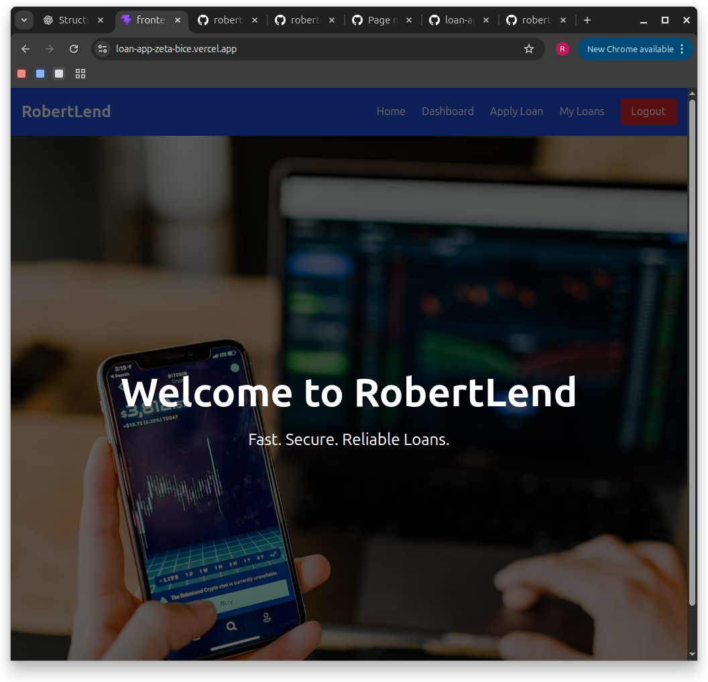
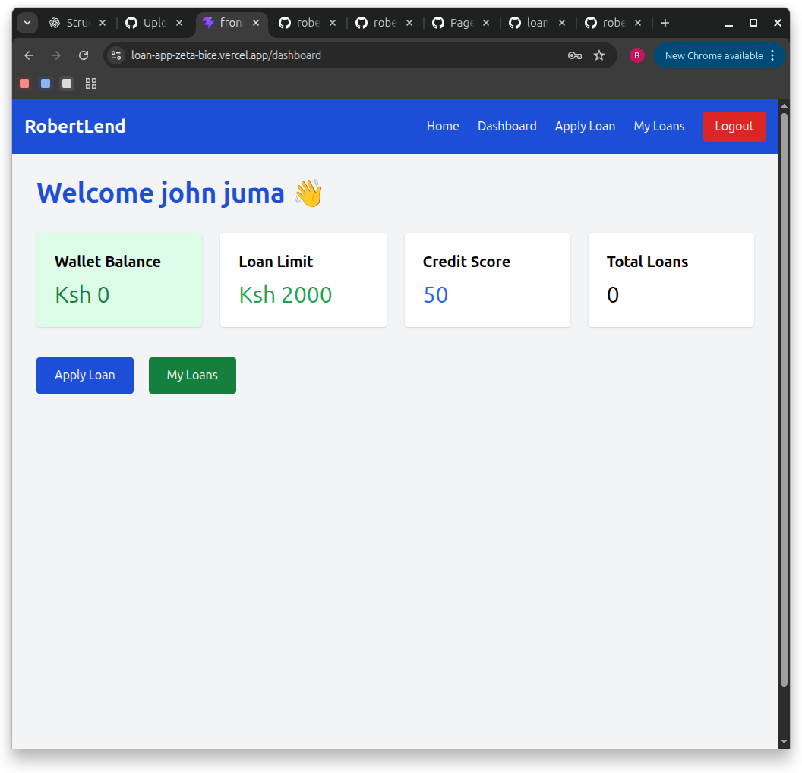

# Loan Management System

A full-stack loan management application designed to simplify loan applications, user authentication, and payment processing through M-Pesa integration.

## 🚀 Live Application

- **Frontend:** https://loan-app-zeta-bice.vercel.app
- **Backend:** https://loan-app-dzbd.onrender.com

## 📌 Project Overview

The Loan Management System is a web-based application that provides users with a platform to interact with loan services. It combines a React frontend with a FastAPI backend and PostgreSQL database to manage application data and backend operations.

## ✨ Key Technologies

### Frontend
- React 19
- JavaScript
- Vite
- Tailwind CSS
- React Router
- Axios

### Backend
- Python
- FastAPI
- SQLAlchemy
- PostgreSQL
- JWT Authentication
- Passlib and bcrypt
- Uvicorn

### Payment Integration
- Safaricom M-Pesa Daraja API
- STK Push integration

### Deployment
- Vercel – Frontend hosting
- Render – Backend hosting
- Neon – PostgreSQL database hosting

## ⚙️ Application Features

- User registration and authentication
- Loan application management
- Secure password hashing
- JWT-based authentication
- M-Pesa STK Push payment integration
- Backend API endpoints
- PostgreSQL database integration

## 🏗️ Project Architecture

```text
loan-app/
├── backend/
│   ├── app/
│   ├── requirements.txt
│   └── ...
│
├── frontend/
│   ├── src/
│   ├── package.json
│   └── ...
│
└── README.md
```

## 💻 Local Development Setup

### 1. Clone the repository

```bash
git clone https://github.com/robert00-1/loan-app.git
cd loan-app
```

### 2. Set up the backend

```bash
cd backend
python3 -m venv venv
source venv/bin/activate
pip install -r requirements.txt
```

Configure your environment variables before starting the backend.

### 3. Start the backend

```bash
uvicorn app.main:app --reload
```

### 4. Set up the frontend

Open another terminal:

```bash
cd loan-app/frontend
npm install
npm run dev
```

## 👨‍💻 Developer

**Robert Mmasi**

Full-Stack Software Developer

- GitHub: https://github.com/robert00-1
- Portfolio: https://portfolio1-zeta-sand.vercel.app

---

## 📸 Application Screenshots

### Home Page


### Dashboard



Developed as a practical full-stack software engineering project.
